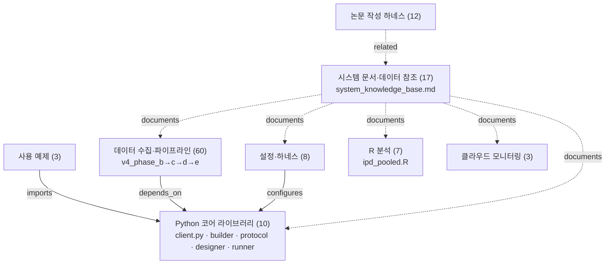
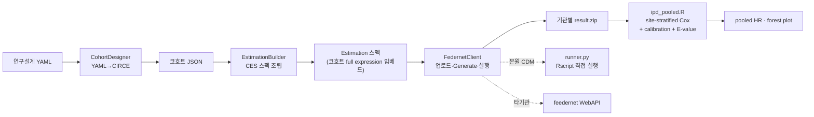
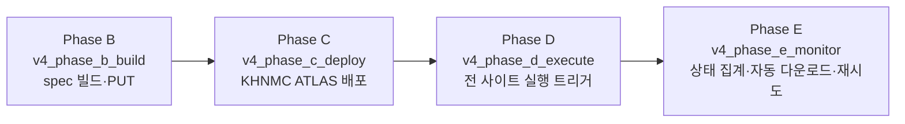

# atlas-auto 아키텍처 개요

> `/understand` 지식 그래프 기반 구조 기록 (사람 판독용).
> 생성일: 2026-07-03 · 분석 commit: `affdbaf` · 원본 그래프: `.understand-anything/knowledge-graph.json`
> 대시보드로 탐색: `/understand-dashboard` (노드 클릭·레이어 필터·투어 재생)
> **재생성**: 코드 구조가 크게 바뀌면 `/understand` 재실행 후 이 문서 갱신.

---

## 1. 한눈에 보기

**atlas-auto** (v0.2.0) — OHDSI ATLAS / feedernet 기반 **다기관 임상연구(OMOP CDM) 자동화 툴킷**. 연구설계 YAML 하나로 코호트 설계 → ATLAS 업로드 → Estimation 실행 → 결과 다운로드를 자동화하고, R로 IPD pooled meta-analysis를 수행한다.

```
┌─────────────────── Python (atlas-auto) ───────────────────┐   ┌──── R ────┐
│  연구설계     코호트 JSON     ATLAS      Estimation   결과   │   │  IPD      │
│  YAML     →  자동생성    →  업로드   →  실행      →  다운로드│ → │  Pooled   │
│  (CohortDesigner) (client)  (builder)  (client)           │   │  (ipd_pooled.R)
└───────────────────────────────────────────────────────────┘   └───────────┘
       본원(DB 직접)   → R 패키지 직접 실행 (CohortMethod)
       타기관(웹 접근) → feedernet WebAPI REST 호출 (client.py)
       결과 통합       → R meta-analysis (site-stratified Cox + calibration)
```

**분석 범위**: 120개 파일 (studies/·_legacy/·대용량 데이터 CSV/JSON 등 588개는 `.understandignore`로 제외).

| 구분 | 값 |
|------|-----|
| 노드 345개 | file 83 · function 221 · document 30 · config 7 · class 4 |
| 엣지 557개 | contains 225 · exports 197 · related 33 · documents 28 · calls 26 · depends_on 23 · imports 19 · configures 6 |
| 언어 | Python(주력) · R · Markdown · YAML · JSON · TOML · Shell |

---

## 2. 아키텍처 레이어 (8)

`/understand`가 디렉토리 구조 + import/의존 위상으로 식별한 8개 레이어. 파일은 각각 정확히 하나의 레이어에 속한다.

### 2.1 Python 코어 라이브러리 (`src/atlas_auto/`, 10개)
pip 패키지의 핵심 API. **가장 결합도 높은 클러스터**이며 다른 레이어가 의존하는 기반.

| 모듈 | fan-in | 역할 |
|------|:---:|------|
| `client.py` | **11** | feedernet 포탈 로그인 → 기관별 ATLAS WebAPI(`/api/v1/atlas/{group_id}/{site_id}`) REST 클라이언트. 코호트·estimation·pathway·concept set·incidence 등 100여 메서드. **패키지의 심장부** |
| `__init__.py` | 5 | barrel — FedernetClient·EstimationBuilder·CohortDesigner·StudyProtocol + runner 함수 3종 재수출, `__all__` 공개 API |
| `builder.py` | 4 | `EstimationBuilder` — ATLAS Estimation(CES) JSON 스펙 조립, Cyclops prior/control 기본값 |
| `protocol.py` | 4 | `StudyProtocol` — YAML → 코호트 생성 → 업로드 → Generate → estimation import → 실행 → 다운로드 전체 오케스트레이션 |
| `cohort_designer.py` | 3 | YAML → ATLAS CIRCE 코호트 JSON 변환 (CIRCE_DEFAULTS·VISIT_TYPE_MAP·DOMAIN_CONFIG) |
| `runner.py` | 3 | 본원(Rscript 직접) + 타기관(WebAPI 원격) 통합 실행 — `run_study` 등 4함수 |
| `cli.py` · `cohort_validator.py` · `data/concepts.py` | — | CLI 진입점 / 코호트 검증 / OMOP Concept ID 레퍼런스 300+ |

### 2.2 데이터 수집·파이프라인 스크립트 (`data/scripts/`, 60개)
feedernet API 기반 운영 스크립트. 코어 라이브러리를 **실제 다기관 연구 운영**에 적용한 계층.

- **v4 estimation 파이프라인 (B→C→D→E)**: `v4_phase_b_build`(spec 빌드·PUT) → `v4_phase_c_deploy`(KHNMC ATLAS 배포) → `v4_phase_d_execute`(전 사이트 실행 트리거) → **`v4_phase_e_monitor`** (fan-in 5, 캐노니컬 live-status 모니터: 상태 집계·완료 자동 다운로드·실패 재트리거)
- **데이터 수집**: `collect_*`(measurement drilldown·unit·value survey), `refresh_achilles_frequency`, `biomarker_stability_summary`(site_concept_matrix·stability_summary 생성)
- **배포/빌드**: `build_v4_cohorts`, `deploy_char_*`, `build_etable*`(논문 e-Table), `build_figures_v3`

### 2.3 R 분석 레이어 (`R/`, 7개)
다기관 통계 분석. **출판 결과를 산출하는 경로.**

| 모듈 | fan-in | 역할 |
|------|:---:|------|
| `lib/ipd_pooled.R` | **4** | IPD pooled Cox 코어 라이브러리 — CmData 풀링, lookback, Cyclops LASSO PS, 1:1 매칭, site-stratified Cox, Schuemie 2014 calibration, E-value, LOSO를 `run_ipd_pooled()` 한 번으로 |
| `lib/driver_template.R` | 2 | ipd_pooled.R을 source하는 study-specific driver 템플릿 |
| `lib/baseline_table1.R` | — | baseline Table 1 (pre/post matching SMD, 한국 CDM·int32 overflow 처리) |
| `compare_v4_chole_regression.R` · `validate_cmdata_patient_level.R` · `install_dependencies.R` · `verify_new_paths.R` | — | 회귀 검증 / CmData 무결성 / 의존성 부트스트랩 / 경로 검증 |

### 2.4 클라우드 모니터링 (`cloud_monitor/`, 3개)
`main.py`(fan-in 3) — GCP Cloud Function. feedernet estimation 상태 조회 → GCS 이전 상태 비교 → 변화·완료 시 Telegram 알림. `DEPLOY.md`(Cloud Scheduler 1시간 주기 배포 절차) + `requirements.txt`.

### 2.5 논문 작성 하네스 (`.claude/agents/` + `docs/paper*`, 12개)
SAP·결과 JSON → Scientific Reports 원고 생성 5-layer 하네스: **orchestrator → researcher-pubmed(L2 refpack) → paper-writer(본문 6섹션) → voice-rewriter(L4 AI 냄새 제거) → validator(L5 감사)**. `docs/paper_reuse/`(재사용 kit), `docs/estimation_output_template.md`, submission guidelines 포함.

### 2.6 시스템 문서·데이터 참조 (17개)
- **`docs/system_knowledge_base.md`** — 마스터 운영 지식(API 체계·실행 레시피·방법론·체크리스트·이슈 패턴)
- `docs/new_study_topic_to_estimation_protocol.md`(fan-in 4) — 신규 연구 14단계 end-to-end 프로토콜
- `README.md` · `CLAUDE.md` · `AGENTS.md` — 최상위 지침(⛔ No Guessing / No Reinventing)
- `data/*/README.md` — concept_frequency·measurement·site_mapping 데이터 카탈로그

### 2.7 설정·하네스 (8개)
`pyproject.toml`(pip 매니페스트, CLI 엔트리포인트) · `.claude/hooks/*.sh`(SessionStart/UserPromptSubmit 컨텍스트 자동 주입) · `.claude/settings.json` · `.understand-anything/*` · 예제 YAML 프로토콜.

### 2.8 사용 예제 (`examples/`, 3개)
`quick_start.py`(4단계 워크플로우) · `new_study_from_scratch.py`(EstimationBuilder 설계) · `download_results.py`(결과 일괄 다운로드).

---

## 3. 데이터 흐름 & 레이어 간 의존

교차 레이어 엣지(주요):

```
사용 예제 ──imports──▶ Python 코어 (3)          예제가 패키지 API 소비
데이터 파이프라인 ──depends_on──▶ Python 코어 (4)  스크립트가 client.py 사용
설정·하네스 ──configures──▶ Python 코어 (4)       pyproject/hooks가 패키지 구성
시스템 문서 ──documents──▶ 코어(9)·파이프라인(7)·R(4)·설정(2)·클라우드(1)
논문 하네스 ◀──related──▶ 시스템 문서 (5)
```

**레이어 의존 다이어그램** (실선=코드 의존, 점선=문서화 관계):



**허브 노드**(fan-in 최상위): `client.py`(11) → `__init__.py`(5) / `v4_phase_e_monitor.py`(5) → `builder.py`·`protocol.py`·`ipd_pooled.R`(4). 즉 **feedernet 클라이언트가 전 계층의 결합점**이고, estimation 모니터와 IPD pooled 라이브러리가 운영·분석 각 축의 중심이다.

**핵심 파이프라인** (README 흐름 = 실제 코드 위상):
1. YAML 연구설계 → `CohortDesigner` → CIRCE 코호트 JSON
2. `EstimationBuilder` → Estimation(CES) 스펙 (estimation spec에 코호트 full expression 임베드 필수)
3. `FedernetClient` → ATLAS 업로드·Generate·estimation 실행 (본원은 `runner`가 Rscript 직접)
4. 운영은 `v4_phase_b→c→d→e` 스크립트가 대량 다기관으로 수행, `v4_phase_e_monitor`가 상태·다운로드·재시도 관리
5. `ipd_pooled.R` → 다기관 결과 통합 (site-stratified Cox + empirical calibration + E-value)

**핵심 파이프라인 다이어그램** (YAML → 코호트 → estimation → 결과 → R):



**운영 파이프라인** (`data/scripts/` v4 Phase B→C→D→E):



---

## 4. 가이드 투어 (12단계)

`/understand`가 README 서사를 실제 import/의존 위상으로 재구성한 학습 경로:

| # | 단계 | 핵심 파일 |
|:--:|------|-----------|
| 1 | 프로젝트 개요 | `README.md` |
| 2 | 패키지 매니페스트·CLI 계약 | `pyproject.toml`, `study_protocol_example.yaml` |
| 3 | 패키지 진입점 (barrel) | `src/atlas_auto/__init__.py` |
| 4 | 코호트 설계 (YAML→CIRCE) | `cohort_designer.py`, `cohort_validator.py` |
| 5 | OMOP Concept 레퍼런스 | `data/concepts.py` |
| 6 | Estimation 스펙 빌드 | `builder.py`, `new_study_from_scratch.py` |
| 7 | **feedernet 클라이언트 (심장부)** | `client.py` |
| 8 | 파이프라인 오케스트레이션·다기관 실행 | `protocol.py`, `runner.py`, `config_example.yaml` |
| 9 | CLI 진입점·Quick Start | `cli.py`, `quick_start.py` |
| 10 | 운영 파이프라인 (Phase B→C→D→E) | `build_v4_cohorts` + `v4_phase_b/c/d/e` |
| 11 | R 통합 분석 (IPD Pooled) | `ipd_pooled.R`, `driver_template.R` |
| 12 | 클라우드 모니터링·논문 하네스 | `cloud_monitor/main.py`, `paper-orchestrator.md`, `system_knowledge_base.md` |

---

## 5. 관련 문서

- **운영 지식(API·레시피·방법론·이슈)**: [system_knowledge_base.md](system_knowledge_base.md)
- **신규 연구 프로토콜(14단계)**: [new_study_topic_to_estimation_protocol.md](new_study_topic_to_estimation_protocol.md)
- **최상위 지침(⛔규칙)**: [../CLAUDE.md](../CLAUDE.md)
- **기계 판독 그래프**: `.understand-anything/knowledge-graph.json` (대시보드 `/understand-dashboard`)

> ⚠️ 이 문서는 commit `affdbaf` 시점 구조 스냅샷이다. 파일 추가/이동/삭제가 크게 발생하면 `/understand` 재실행 후 갱신할 것.
